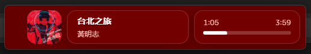

# Miniplayer 3-Section

> A Spicetify extension that turns Spotify's mini player into three horizontal sections:
> **cover art ｜ title & artist ｜ time & progress bar** — frosted glass cards,
> album-art-driven colors, one consistent corner radius.



## 组件简介

把 Spotify 原生的迷你播放器改成了横向三段式：左边是圆角方形专辑封面，中间是歌手 + 歌名，右边是播放进度（时间在上、进度条在下）。三块卡片**圆角一致、间距一致、纵向高度一致**，窗口底色、卡片、文字和进度条都会跟随当前专辑封面变化。

## Features

- Three horizontal sections: cover art / track info / progress
- Frosted-glass cards over a blurred cover-art backdrop (album-art-driven colors)
- Consistent corner radius for all three cards (8px, matching the Windows 11 window radius)
- Compact default size (320×76) that is applied once on first open — resize it however you like afterwards
- Right-hand timer forced to the **total duration** instead of a countdown
- Playback controls stay hidden on the cover and fade in on hover

## Requirements

- Spicetify 2.45+ (extension support)
- Spotify desktop **1.3.3.264** (tested on Windows 11, if miniplayer is not available on old platforms some changes may be added) — see *Compatibility* below
- The mini player must be the Document Picture-in-Picture window (default in current desktop builds)

## Install

### From the Marketplace

Search for **Miniplayer 3-Section** in the Spicetify Marketplace → *Extensions* tab → **Install**.

### Manual

1. Download [`dist/pip-3-sections.js`](dist/pip-3-sections.js).

2. Copy it into your Spicetify extensions folder:
   
   - Windows: `%appdata%\spicetify\Extensions\`
   - macOS / Linux: `~/.config/spicetify/Extensions/`

3. Enable it and apply:
   
   ```sh
   spicetify config extensions pip-3-sections.js
   spicetify apply
   ```

Then restart Spotify and open the mini player.

## Compatibility

Spotify's client UI is minified and its class names are hashed, and they change
between releases. This extension targets Spotify **1.3.3.264**. Most selectors use
stable `data-testid` attributes (`pip-hover-element`, `document-pip-hover-element`,
`progress-bar`, `playback-duration`, …); the layout ones use the current hashed
class names, so a Spotify update may require updating them in
`src/pip-3-sections.css`.

The window's own rounded corners are drawn by the operating system and **cannot be
changed** by CSS — the three cards are set to 8px so that they match the window on
Windows 11. On another OS/theme you can change `--pip-radius` to whatever the system
window radius looks like.

## License

[MIT](LICENSE)
